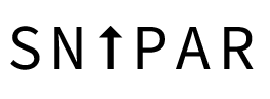
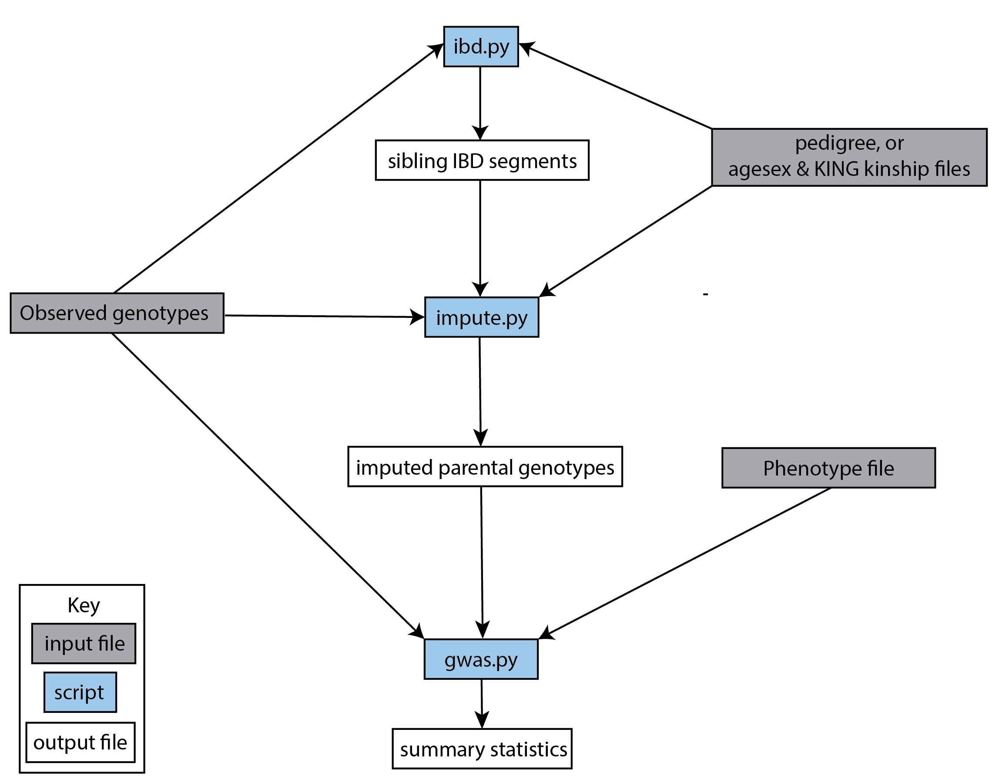

# snipar

  

*snipar* (single nucleotide imputation of parents) provides a command line toolbox for family-based analyses in genetics: 

- **family-GWAS**: Perform family-GWAS (FGWAS) with a variety of estimators. *snipar* can perform family-GWAS using genetic differences between siblings, parent-offspring trios, and increase power through using imputed parental genotypes, which enables inclusion and optimal use of samples with only one parent genotyped and without genotyped parents or siblings. See [Simulation Exercise: family-GWAS without imputed parental genotypes](https://snipar.readthedocs.io/en/latest/simulation.html#family-based-gwas-without-imputed-parental-genotypes) and [Simulation Exercise: family-GWAS with imputed parental genotypes](https://snipar.readthedocs.io/en/latest/simulation.html#family-based-gwas-with-imputed-parental-genotypes). The regressions are performed in an efficient linear mixed model that accounts for correlations between siblings and more distant relatives.
- **Family PGS analyses**: `pgs.py` computes family scores from observed or imputed genotypes and fits linear mixed models for quantitative traits. It also supports adjustment for assortative mating. For a binary trait, `pgs.R` fits logistic mixed models using the same score file. Both workflows report the direct-to-population PGS coefficient ratio and its standard error. See the [Python PGS guide](https://snipar.readthedocs.io/en/latest/pgs.html) and [R PGS guide](https://snipar.readthedocs.io/en/latest/pgs_binary.html).
- **Imputation of missing parental genotypes**: For samples with at least one genotyped sibling and/or parent, but without both parents' genotypes available, *snipar* can impute missing parental genotypes according to Mendelian laws (Mendelian Imputation) and use these to increase power for family-GWAS and PGS analyses. See [Tutorial: imputing-missing-parental-genotypes](https://snipar.readthedocs.io/en/latest/tutorial.html#imputing-missing-parental-genotypes)
- **Identity-by-descent (IBD) segments shared by siblings**: *snipar* implements a hidden markov model (HMM) to accurately infer identity-by-descent segments shared between siblings. The output of this is needed for imputation of missing parental genotypes from siblings. See [Tutorial: inferring IBD between siblings](https://snipar.readthedocs.io/en/latest/tutorial.html#inferring-ibd-between-siblings)
- **Multi-generational forward simulation with indirect genetic effects and assortative mating**: *snipar* includes a simulation module that performs forward simulation of multiple generations undergoing random and/or assortative mating. The phenotype on which assortment occurs can include indirect genetic effects from parents. The simulator can generate founder haplotypes or read phased haplotypes from BGEN or VCF. Output includes a multigenerational pedigree with phenotype values, direct and indirect genetic component values, and plink formatted genotypes for the final two generations along with imputed parental genotypes. See [Simulation Exercise](https://snipar.readthedocs.io/en/latest/simulation.html). The simulator also supports stabilizing selection on breeder phenotypes over multiple generations. See [Simulating stabilizing selection](https://snipar.readthedocs.io/en/latest/simulation.html#simulating-stabilizing-selection).
- **Correlations between GWAS effects**: `correlate.py` fits a joint covariance matrix for direct effects and non-transmitted coefficients (NTCs) using their per-SNP sampling covariance. It derives population effects as direct effects plus average NTCs. The results include the direct–population and direct–NTC correlations and the population-to-direct standard deviation ratio, with genomic block jackknife standard errors. See the [correlation guide and output tables](https://snipar.readthedocs.io/en/latest/correlate.html).

  

Family GWAS and PGS analyses can use observed genotypes and a pedigree. SNIPar accepts PLINK BED, phased or unphased BGEN, and phased or unphased VCF. Parent-offspring imputation can proceed without IBD inference. [End-to-end tutorial](https://snipar.readthedocs.io/en/latest/tutorial.html)

# Publications

**Please cite at least one of these publications if you use snipar in your work!**

The methodologies implemented in *snipar* are described in the following publications: 

     
**Mendelian imputation of parental genotypes improves estimates of direct genetic effects.**   
[Alexander Strudwick Young](https://alextisyoung.github.io/), SM Nehzati, ..., Augustine Kong.  
Describes the method for imputation of missing parental genotypes and family-based GWAS with imputed parental genotypes.  
[🔗 Full Text](https://www.nature.com/articles/s41588-022-01085-0)

     
**Estimation of indirect genetic effects and heritability under assortative mating.**   
[Alexander Strudwick Young](https://alextisyoung.github.io/).    
Describes family-PGS analysis with adjustment for the impact of assortative mating on estimates of indirect genetic effects.  
[🔗 Full Text](https://www.biorxiv.org/content/10.1101/2023.07.10.548458v1)

     
**Family-GWAS reveals effects of environment and mating on genetic associations.** .   
Tammy Tan, H Jayashankar, J Guan, SM Nehzati, M Mir, M Bennett, E Agerbo, ..., [Alexander Strudwick Young](https://alextisyoung.github.io/).    
Shows *snipar* applied to generate family-GWAS summary statistics from 17 different cohorts that are meta-analyzed. Describes the methodology for estimating genome-wide correlations between the different classes of effects estimated by family-GWAS.  
[🔗 Full Text](https://doi.org/10.1101/2024.10.01.24314703)

   
**Family-based genome-wide association study designs for increased power and robustness.**  
Describes additional family-GWAS designs: the *unified estimator*, which increases power for estimating direct genetic effects in homogeneous samples (typical for GWAS) by including all samples through linear imputation; and the *robust estimator*, which maximizes power in strongly structured or admixed samples without introducing bias. The linear mixed model used in *snipar* family-GWAS and PGS analyses is described here.    
Junming Guan, T Tan, SM Nehzati, M Bennett, P Turley, DJ Benjamin, [Alexander Strudwick Young](https://alextisyoung.github.io/).  
[🔗 Full Text](https://www.nature.com/articles/s41588-025-02118-0)

# Documentation

Documentation: https://snipar.rtfd.io/

It is recommended to read the guide: https://snipar.rtfd.io/en/latest/guide.html

And to work through the tutorial (https://snipar.readthedocs.io/en/latest/tutorial.html) and simulation exercise (https://snipar.readthedocs.io/en/latest/simulation.html). 

## Supported genotype formats

| Format | Option | Input |
| --- | --- | --- |
| PLINK BED | `--bed` | BED prefix with matching `.bim` and `.fam` files |
| BGEN | `--bgen` | Phased or unphased BGEN prefix, with a `.sample` file when sample IDs are external |
| VCF | `--vcf` | Phased or unphased diploid, biallelic autosomal `GT` calls in plain, gzip, or BGZF files |

Parental imputation uses chromosome-wide phase from BGEN or VCF when available. VCFs with a recognized quality tag and BGENs with `--bgen-quality` use a default variant quality cutoff of 0.99. [Input file reference](https://snipar.readthedocs.io/en/latest/input%20files.html#observed-genotypes) · [Phased VCF tutorial](https://snipar.readthedocs.io/en/latest/tutorial.html#using-the-phased-vcf)

# Installing Using pip

SNIPar requires Python 3.11.5 through 3.14. On Intel macOS use Python 3.11 or 3.12 for prebuilt dependencies. Python 3.12 is a suitable choice on Linux, Windows and macOS, including Apple Silicon. With Conda, create and activate an environment named `snipar`.

> `conda create -n snipar python=3.12 pip`

> `conda activate snipar`

Install the published release with the Python interpreter in that environment.

> `python -m pip install --upgrade pip`

> `python -m pip install snipar`

The Python tools install together and include the VCF reader. To run the binary-trait command `pgs.R`, also install R and its `lme4` package. In a Conda environment you can install both with one command.

> `conda install -c conda-forge r-base r-lme4`

# Installing From Source

To install the version in a repository checkout, run the following command from the directory containing `pyproject.toml`.

> `python -m pip install .`

A source build compiles two C++ extensions and requires a C++ compiler with OpenMP support. Use GCC and its OpenMP runtime on Linux or the Microsoft C++ Build Tools on Windows. On macOS, install the Xcode Command Line Tools and the OpenMP runtime for your architecture.

> `xcode-select --install`

> `brew install libomp`

SNIPar detects Homebrew's default `libomp` location and the active environment's `include/omp.h`. For a custom installation, set `SNIPAR_OPENMP_PREFIX` to the directory containing the OpenMP `include` and `lib` directories before running the source install.

# Running tests
To check that the code is working properly and that the C modules have been compiled, you can run the tests using this command:

> `python -m unittest snipar.tests`
